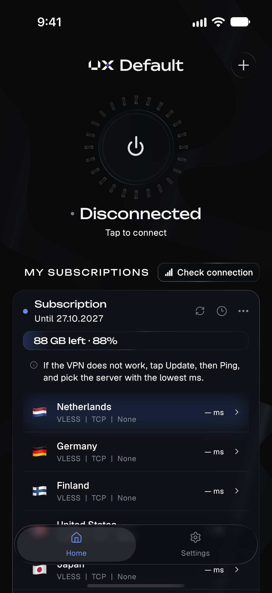
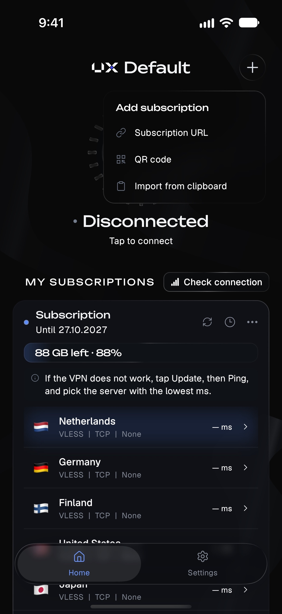
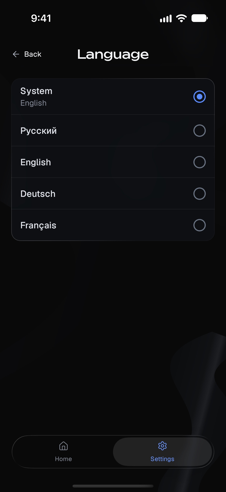
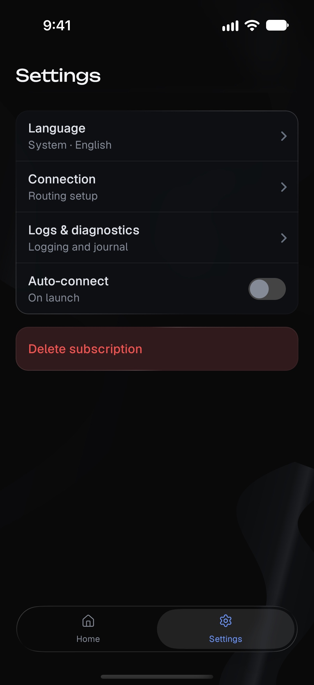

  

<h1 align="center">UXWay</h1>

VPN client for iPhone, iPad, Android and Android TV.

  <strong><a href="https://github.com/DigneZzZ/UXWay/releases/latest/download/UXWay.apk">Download for Android</a></strong>
  &nbsp;·&nbsp;
  <strong><a href="https://apps.apple.com/us/app/uxway/id6762559624">Download on the App Store</a></strong> 
  Android 7.0+ · iOS / iPadOS 16.2+

  <a href="https://github.com/DigneZzZ/UXWay/releases">All releases</a>

Add your subscription by link or QR code. Deep links use `uxway://add/{LINK}` | `uxway://add/{vless://}`

  
  
  
  

sponsored by [ux.cloud](https://ux.cloud) 
developed by [ux.cloud](https://ux.cloud) — [t.me/firewookie](https://t.me/firewookie)
